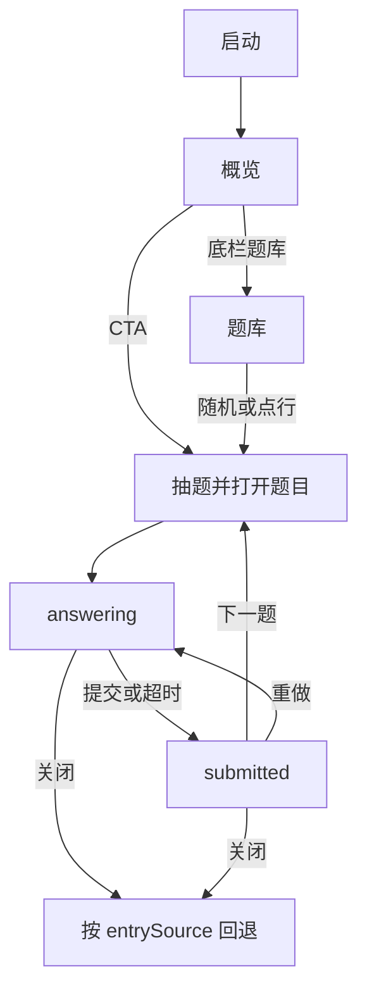
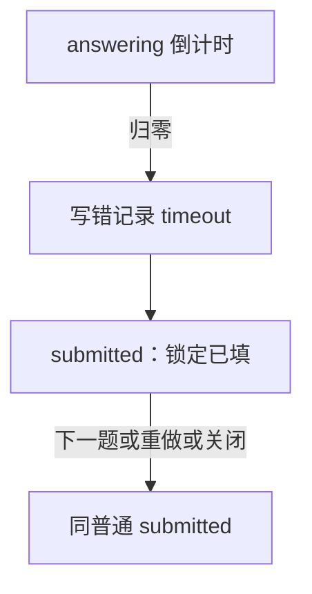

# p7 交互设计说明书 · 2.0

| 项 | 内容 |
| --- | --- |
| 文档状态 | **Ready for Build**（行为规格以本文为准） |
| 关联 | [产品需求](产品需求文档.md) · [前端（视觉/布局）](前端设计文档.md) · [架构](架构文档.md) |
| 平台 | Android 原生，竖屏，离线 |
| 修订 | 2.0.1：闭合歧义与评审项；相对 1.x 为信息架构重做 |

**分工**：需求定义目标与范围；**本文定义用户怎么走、每屏什么状态、什么反馈**；前端文档定义视觉与控件形貌；架构定义数据与判定实现。若冲突：**行为以本文为准，视觉以前端为准，协议以架构为准**。

---

## 1. 目标与成功标准

### 1.1 用户目标

在 1–3 分钟内完成一道真假话推演：自己维持中间状态 → 一次提交 → 对照判定与推演 → 决定下一题或停下。事后能从概览/记录回看答题表现。

### 1.2 产品目标

- 强化心智模拟练习场景，弱化「清题库 / 背题号」。
- 大题量下仍可浏览、可统计，主路径不卡在全量列表。

### 1.3 指标边界（必读）

概览上的首次正确率、近 7 日提交数衡量的是**答题表现**，**不声称**已证明心智模拟能力提升。正确率上升可能来自记忆、套路或抽题难度波动。UI **不展示耗时**（除非用户明确要正计时/挑战倒计时）。

最小可区分口径（统计层，本版须支持或可派生）：

| 口径 | 定义 |
| --- | --- |
| 首次接触 | 该 `qid` 的第一条提交 |
| 重复作答 | 同 `qid` 的非首次提交 |
| 未见过的新题 | 状态为「未做」时进入并完成的首次提交 |

延迟再测、迁移实验不作为 2.0 交互验收阻塞项；见产品需求。

### 1.4 可验收成功标准（交互层）

| ID | 标准 |
| --- | --- |
| S1 | 冷启动 ≤3 次点击进入作答（概览 → CTA，或底栏题库 → 随机/点行） |
| S2 | 任一筛选组合下题库为分页，单页 ≤30 行；无「一级加载全部题号」 |
| S3 | 答题过程中界面不出现任何正确答案、对错提示、推演正文 |
| S4 | 提交后默认不展开推演；须显式「查看推演」 |
| S5 | 关闭题目页不产生新记录；仅提交或挑战超时写记录 |
| S6 | 概览展示各级已对/总量，以及首次正确率（算法见需求 §4.2 / 架构 §5.1） |
| S7 | 题库行状态仅为：未做 / 尝试 / 已对 |
| S8 | 题目页可查看该题提交历史（时间/对错/强度）；不展示耗时、不还原当时勾选 |
| S9 | 挑战档非使用产品的必要条件（默认标准档即可完整练习） |

---

## 2. 设计原则

1. **练习器，不是目录站** — 统计与筛选服务「再练一题」，不为收藏题号。
2. **提交前零剧透** — 不给中间结果、进度条式「接近正确答案」、草稿检测。
3. **提交后可回推** — 先判定，推演折叠；对了也可以看推演。
4. **记录只增** — 每次 Attempt 一条；重做不覆盖历史。
5. **长题面诚实** — 题面常驻可回看；不用藏题面假装增加难度。
6. **挑战可选** — 加压模式，不是主路径门槛。
7. **文案克制** — 无庆祝、无感叹号、无 emoji（与前端文案表一致）。

---

## 3. 角色与场景

本产品无账号。唯一角色：**练习者**（单机）。

| 场景 | 触发 | 期望路径 |
| --- | --- | --- |
| SC1 日常开练 | 打开 App | 概览 → CTA 进题 → 连做 → 关闭回概览 |
| SC2 挑难度 | 想练 L4 | 概览点 L4 条或题库筛 L4 → 随机/点题 |
| SC3 专攻未做 | 想刷新题 | 题库状态=未做 → 随机或翻页点题 |
| SC4 从记录再练 | 想对着错过的题再推 | 记录点行 → **新开作答**（非回放该次提交） |
| SC5 加压 | 自愿 | 概览设置改挑战 → 下一题起倒计时 |
| SC6 中途放弃 | 推不动 | 关闭；无记录、状态不变 |

---

## 4. 信息架构

```
App
├── 概览（默认落地页）
│   ├── 进度、采样指标、主 CTA、最近提交
│   └── 设置（强度、版本）← 强度的唯一入口
├── 题库（筛选 × 分页 × 随机）
├── 记录（Attempt 时间线 → 重做入口）
└── 题目（全屏）
```

底栏仅：**概览 | 题库 | 记录**。题目页隐藏底栏。

**记录产品意图**：时间线审计每一次 Attempt，点入 = 对该 `qid` **重新作答**；本版**不做**「某次提交的只读回放 / 当时作答还原」。

---

## 5. 跨文档决策表（唯一行为）

实现与其它文档冲突时以本表为准。

| 主题 | 唯一决策 |
| --- | --- |
| 强度入口 | **仅**概览右上角「设置」；别处不放修改入口 |
| 概览默认筛选 vs 题库筛选 | **单向**：概览点分级条只写入概览默认难度并跳转题库；题库内改筛选不回写概览默认 |
| 卡点 | **已删除**：提交后不展示自报；新记录 `stuck` 恒 null（旧字段仅兼容读） |
| 本题提交 | 题目页展示该 qid 历史 Attempt 元数据；点入仍是新作答，不是某次回放 |
| 记录点入 | 新开 `answering`，空白作答，不预填；不是历史审阅页 |
| 题库/概览点入已对题 | 同上，不预填 |
| `lastQid` | 全局一个字段：任意成功进入并开始作答的题更新之；「下一题/随机」在**当前 `filterSnapshot`** 池内避开它 |
| `filterSnapshot` | 进入题目页时固化；本页内「下一题」只用该快照；从记录进入时快照 = 进入瞬间题库当前筛选（若从记录进则用「全部难度+全部状态」） |
| 关闭回退 | 见 §6.1 导航表 |
| 超时后按钮 | 与普通 `submitted` 相同：**下一题 + 重做**；提交键隐藏；不把提交键改成重做 |
| 两列作答 | 人数 ≥7 时两列 |
| 挑战时限 | 初值见架构；标为待校准，不当作已验证负荷 |

---

## 6. 关键用户流程

### 6.1 导航状态表（关闭 / 系统返回）

进入题目时记录 `entrySource`：

| entrySource | 如何产生 | 关闭或系统返回落点 |
| --- | --- | --- |
| `overview` | 概览 CTA、概览最近提交 | 概览 |
| `bank` | 题库点行、题库随机 | 题库（保留筛选与页码） |
| `history` | 记录点行 | 记录（保留滚动/页码） |
| `next` | 题目页内「下一题」 | **继承进入上一道题时的 entrySource**（若链上最初是 overview CTA，则回概览；最初是 bank 则回题库） |

说明：从概览 CTA 抽到的第一题 `entrySource=overview`；其上点「下一题」新题仍携带 `entrySource=overview`（实现可复制字段，不必用 `next` 覆盖来源）。`source` 枚举里的 `next` 仅表示「由下一题打开」，回退仍看继承的 `entrySource`。

### 6.2 主路径（示意；回退以 §6.1 为准）



### 6.3 记录回访


### 6.4 挑战超时



### 6.5 题目页状态机

| 状态 | 可进入动作 | 界面要点 |
| --- | --- | --- |
| `answering` | 进入、重做 | 题面可见；作答可编辑；提交可见；无结果区；挑战跑表 |
| `submitted` | 提交、超时 | 作答锁定；结果区可见；推演默认收起；**下一题 + 重做**；提交隐藏 |
| 离开 | 关闭 / 返回 | 来自 `answering` 且未提交 → **不写记录** |

不允许：`answering` 中显示推演或对错色标在选项上。

---

## 7. 全局交互模式

### 7.1 反馈

| 类型 | 用法 |
| --- | --- |
| 页内判定 | 提交后大字「对/错」 |
| Toast | 仅异常一句 |
| 无确认框 | 关闭、切底栏、改强度均不二次确认 |

### 7.2 强度

仅设置 Dialog 可改。改后**当前已打开题目页不变**；下一题或重做载入起生效。

| 档 | 倒计时 | 题面 |
| --- | --- | --- |
| 宽松 / 标准 | 无 | 常驻 |
| 挑战 | 按级初值时限 | 常驻；归零→§6.4 |

### 7.3 抽题

在 `filterSnapshot` 池中均匀随机；池大小>1 时排除 `lastQid`。产品池：`type=truth` 且 `mode=answer`。

---

## 8. 分屏规格

### 8.1 概览

| 区块 | 行为 |
| --- | --- |
| 设置 | 强度 + 版本只读 |
| 分级条 | 点击→题库，难度=该级，状态=全部，页码=1；并写入概览默认难度 |
| 采样 | 首次正确率、近 7 日；文案勿暗示「能力已提升」 |
| 主 CTA | 用概览默认筛选抽题（初值 L2 + 全部状态） |
| 最近提交 | ≤10 行；点行→题目，`entrySource=overview` |

题库异常：隐藏 CTA 与分级可点；居中错误文案。

### 8.2 题库

筛选变更→页码回 1。随机在当前池抽题。行：题号、人数、状态。每页 30。

### 8.3 记录

行展示该次 Attempt 元数据。点行→该 qid 新作答（§4 意图）。每页 50。无记录→空态。

### 8.4 题目页

#### answering

顶栏含关闭；挑战含计时（≤10s 变色+数字）。作答：每人真话/撒谎；≥7 人可两列；无撒谎人数框。提交始终可点。页底「本题提交」有则显示。

#### submitted

- 判定对/错  
- 查看/收起推演  
- **下一题 | 重做本题**  
- 提交键：隐藏  
- 「本题提交」刷新含本条  

超时：已填锁定保留；按钮集合与上相同（仍有下一题）。

推演区：不对选项按对错染色。无卡点自报。

---

## 9. 文案与语气

见 [前端设计 §7](前端设计文档.md)。交互附加：

| 情境 | 文案 |
| --- | --- |
| 无首次数据 | 暂无首次数据 |
| 题库异常 / 版本不匹配 | 题库异常 / 题库与 app 版本不匹配 |
| 抽题失败 | 没有可抽的题 |
| 超时标记 | 超时 |
| 本题提交 | 本题提交 |

---

## 10. 无障碍与设备验收（基线）

| 项 | 要求 |
| --- | --- |
| 触控 | 主按钮 ≥48dp；列表行 ≥56dp |
| 对比 | 浅色主题正文可读 |
| 计时 | 挑战档数字变化，不单靠颜色 |
| 挑战 | 可选；默认标准档须能完成 SC1 |
| 系统字体放大 | 题面与作答不裁切关键控件（真机抽测） |
| 长题干 | 整页可滚，顶栏/提交在滚动策略上可到达 |
| TalkBack | 首版：顶栏、提交、对错、主要按钮有可读 label；完整朗读顺序不阻塞 2.0 |
| 横屏 | 不支持 |

---

## 11. 异常与边界

| ID | 情况 | 处理 |
| --- | --- | --- |
| E1/E2 | 题库失败/版本过高 | 概览错误态；不可开题 |
| E3 | 筛选为空 | 空态；随机禁用 |
| E4 | 下一题池仅 1 题 | 允许同题重载 |
| E5 | 部分未选 | 记错 + `partial` |
| E6 | 超时与提交并发 | 只写一条 |
| E7 | 杀进程于 answering | 无新记录 |
| E8 | 推演很长 | 整页滚 |
| E9 | 记录 qid 已下架 | Toast「题目已下架」 |

---

## 12. 已决策项（原 O1–O4）

| ID | 决策 |
| --- | --- |
| D1 | 筛选同步：单向（见 §5） |
| D2 | 不做卡点自报；题目页展示本题提交历史 |
| D3 | 任何入口进入均不预填上次作答 |
| D4 | ≥7 人两列 |

变更须改本文并升修订号。

---

## 13. 相对 1.x 废止

首页全量列表、列表首次对错列、藏题面、第一步门禁、撒谎人数框、强制展开答案、账本入口。

---

## 14. 验收清单（交互 QA）

- [ ] S1–S9  
- [ ] SC1–SC6  
- [ ] E1–E9  
- [ ] §5 决策表与实现一致  
- [ ] §6.1 回退表抽测（overview/bank/history/下一题链）  
- [ ] 文案无庆祝/emoji  

---

## 15. 文档变更记录

| 版本 | 日期 | 说明 |
| --- | --- | --- |
| 2.0 | 2026-10-23 | 首版 |
| 2.0.1 | 2026-10-23 | 决策表、导航表、指标边界、记录意图、卡点不阻塞、超时按钮统一、O→已决策 |
| 2.0.2 | 2026-10-23 | 删除卡点自报；题目页增加本题提交历史 |
