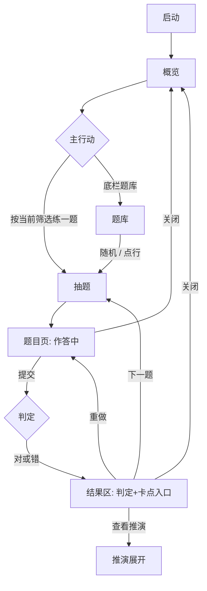
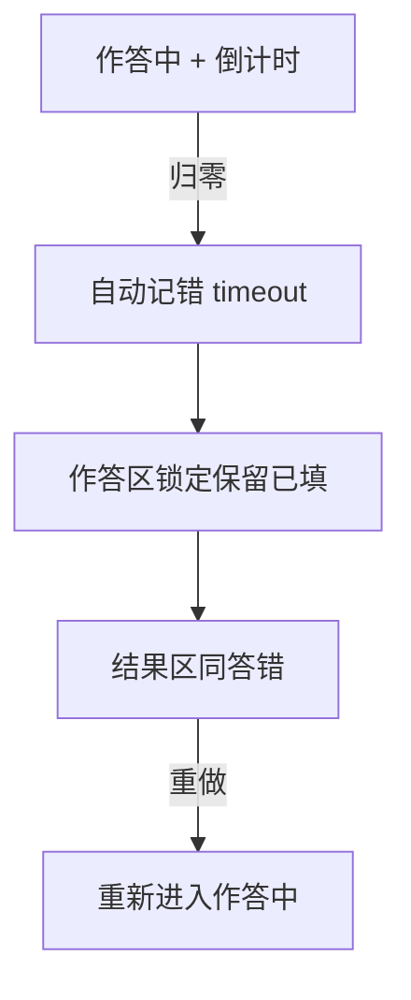

# p7 交互设计说明书 · 2.0

| 项 | 内容 |
| --- | --- |
| 文档状态 | **Ready for Build**（行为规格以本文为准） |
| 关联 | [产品需求](产品需求文档.md) · [前端（视觉/布局）](前端设计文档.md) · [架构](架构文档.md) |
| 平台 | Android 原生，竖屏，离线 |
| 修订 | 2.0 首版；相对 1.x 为信息架构重做 |

**分工**：需求定义目标与范围；**本文定义用户怎么走、每屏什么状态、什么反馈**；前端文档定义视觉与控件形貌；架构定义数据与判定实现。若冲突：**行为以本文为准，视觉以前端为准，协议以架构为准**。

---

## 1. 目标与成功标准

### 1.1 用户目标

在 1–3 分钟内完成一道真假话推演：自己维持中间状态 → 一次提交 → 对照判定与推演 → 决定下一题或停下。事后能从概览/记录回看自己推得怎么样。

### 1.2 产品目标

- 强化心智模拟，弱化「清题库 / 背题号」。
- 大题量下仍可浏览、可统计，主路径不卡在全量列表。

### 1.3 可验收成功标准（交互层）

| ID | 标准 |
| --- | --- |
| S1 | 冷启动 ≤3 次点击进入作答（概览 → CTA，或底栏题库 → 随机/点行） |
| S2 | 任一筛选组合下题库为分页，单页 ≤30 行；无「一级加载全部题号」 |
| S3 | 答题过程中界面不出现任何正确答案、对错提示、推演正文 |
| S4 | 提交后默认不展开推演；须显式「查看推演」 |
| S5 | 关闭题目页不产生新记录；仅提交或挑战超时写记录 |
| S6 | 概览展示各级已对/总量，以及首次正确率（定义见需求 §4） |
| S7 | 题库行状态仅为：未做 / 尝试 / 已对（定义见需求 §4.1） |

---

## 2. 设计原则

1. **练习器，不是目录站** — 统计与筛选服务「再练一题」，不为收藏题号。
2. **提交前零剧透** — 不给中间结果、进度条式「接近正确答案」、草稿检测。
3. **提交后可回推** — 先判定，推演折叠；对了也可以看推演。
4. **记录只增** — 每次 Attempt 一条；重做不覆盖历史。
5. **长题面诚实** — 题面常驻可回看；不用藏题面假装增加难度。
6. **文案克制** — 无庆祝、无感叹号、无 emoji（与前端文案表一致）。

---

## 3. 角色与场景

本产品无账号。唯一角色：**练习者**（单机）。

| 场景 | 触发 | 期望路径 |
| --- | --- | --- |
| SC1 日常开练 | 打开 App | 概览看一眼指标 → CTA 进题 → 连做数题 → 关题回概览 |
| SC2 挑难度 | 想练 L4 | 概览点 L4 条 或 题库筛 L4 → 随机/点题 |
| SC3 专攻未做 | 想刷新题 | 题库：状态=未做 → 随机或翻页点题 |
| SC4 回看错题痕迹 | 想知道最近错在哪 | 记录时间线 或 概览最近提交 → 进题重做 |
| SC5 加压 | 改挑战档 | 设置改强度 → 下一题起倒计时 |
| SC6 中途放弃 | 推不动 | 关闭；无记录、状态不变 |

---

## 4. 信息架构

```
App
├── 概览（默认落地页）
│   ├── 进度（各级已对/总量）
│   ├── 能力采样（首次正确率、近 7 日）
│   ├── 主行动：按当前筛选练一题
│   ├── 最近提交（入口到题目）
│   └── 设置（强度、版本）
├── 题库
│   ├── 筛选：难度 × 状态
│   ├── 随机一题（当前筛选）
│   └── 分页列表 → 题目
├── 记录
│   └── 提交时间线 → 题目
└── 题目（模态式全屏，非底栏项）
    ├── 题面 / 作答 / 提交
    └── 判定 / 卡点 / 推演 / 下一题|重做
```

底栏仅三项：**概览 | 题库 | 记录**。题目页覆盖全屏并隐藏底栏。

---

## 5. 关键用户流程

### 5.1 主路径：开练 → 提交 → 下一题



### 5.2 记录回访


### 5.3 挑战超时



### 5.4 题目页状态机

| 状态 | 可进入动作 | 界面要点 |
| --- | --- | --- |
| `answering` | 进入题目、重做 | 题面可见；作答可编辑；提交可用；无结果区；挑战档跑表 |
| `submitted` | 提交成功、超时 | 作答锁定；结果区可见；推演默认收起；可下一题/重做/关闭 |
| （离开） | 关闭 / 系统返回 | 若来自 `answering` 且未提交 → **不写记录** |

不允许：`answering` 中显示推演或对错色标在选项上。

---

## 6. 全局交互模式

### 6.1 导航

| 模式 | 规则 |
| --- | --- |
| 底栏切换 | 概览↔题库↔记录；保留各自滚动位置与题库筛选/页码（进程内） |
| 进入题目 | 传入 `qid` + `source`∈{overview,bank,history,next} + `filterSnapshot` |
| 关闭题目 | 回 `source`；`next` 产生的题关闭时回 **题库**（若从概览 CTA 进来则回概览） |
| 系统返回键 | 题目→来源；底栏页→退出 App（系统默认） |

### 6.2 反馈

| 类型 | 用法 |
| --- | --- |
| 页内判定 | 提交后大字「对/错」，不用 Toast 报对错 |
| Toast | 仅异常：题库空、抽题失败等一句 |
| 无确认框 | 关闭题目、切换底栏、改强度：均不二次确认 |

### 6.3 强度（全局）

改设置后**当前已打开的题目页不改规则**；从下一道题（含下一题/重做重新载入）起用新强度。

| 档 | 倒计时 | 题面 |
| --- | --- | --- |
| 宽松 / 标准 | 无 | 常驻 |
| 挑战 | 按级时限（见架构） | 常驻；归零→§5.3 |

### 6.4 抽题

在 `filterSnapshot` 对应池中均匀随机；池大小>1 时排除 `lastQid`。产品池仅 `type=truth` 且 `mode=answer`。

---

## 7. 分屏规格

每屏给出：**目的、布局区块、元素行为、状态**。视觉尺寸见前端文档。

### 7.1 概览

**目的**：回看进度与能力，一键开练。

| 区块 | 元素 | 行为 |
| --- | --- | --- |
| 顶栏 | 标题、设置 | 设置→Dialog |
| 总览 | 已对总数 | 只读 |
| 分级 | L1–L5：已对/总量 + 人数提示 | 点击→切到题库，难度=该级，状态=全部，页码=1 |
| 采样 | 首次正确率、近 7 日提交数（及可选中位用时） | 只读；无首次记录时文案「暂无首次数据」 |
| 主 CTA | 「按当前筛选练一题」 | 用概览持有的默认筛选抽题；默认筛选初值：难度 L2、状态全部；从题库改筛选不自动改概览默认，除非点过分级条（分级条写入难度） |
| 最近 | ≤10 条提交 | 点行→题目；无则隐藏整块或显示「还没有提交」 |

**状态**

| 状态 | 表现 |
| --- | --- |
| 正常 | 上表 |
| 题库异常 | 隐藏 CTA 与分级可点性；居中错误文案（见文案） |
| 进度空 | 已对全 0；CTA 仍可用 |

### 7.2 题库

**目的**：在子集中挑选或随机。

| 区块 | 行为 |
| --- | --- |
| 难度筛选 | 单选：全部/L1…L5；变更→页码重置为 1，刷新列表 |
| 状态筛选 | 单选：全部/未做/尝试/已对；同上 |
| 随机一题 | 当前筛选池抽题；池空→禁用 |
| 列表行 | 题号、人数、状态；点→题目 |
| 分页 | 每页 30；上/下页；非法页夹紧 |

**状态**

| 状态 | 表现 |
| --- | --- |
| 有数据 | 列表+分页 |
| 筛选为空 | 空态文案；随机禁用；分页隐藏 |
| 题库异常 | 同概览级错误，列表不可用 |

### 7.3 记录

**目的**：按时间审计每一次 Attempt。

| 区块 | 行为 |
| --- | --- |
| 列表行 | 时间、题号、对/错、用时、强度；超时则附加「超时」 |
| 点行 | 进该 qid 题目页（新开作答，不自动展开历史对错以外的推演） |
| 分页 | 每页 50，新→旧 |

**状态**：无记录→空态文案。

### 7.4 题目页

**目的**：完成单次推演闭环。

#### 7.4.1 `answering`

| 区域 | 规则 |
| --- | --- |
| 顶栏 | 题号·强度名；挑战显示计时；关闭 |
| 题面 | 常驻；可滚 |
| 作答 | 每人「真话|撒谎」；未选不算默认真话；无撒谎人数框 |
| 提交 | 始终可点（含全空） |

挑战计时：进入 `answering` 时启动（含重做）；顶栏展示；≤10s 变错色。

#### 7.4.2 `submitted`

| 区域 | 规则 |
| --- | --- |
| 作答 | 锁定，保留提交时内容 |
| 判定 | 对 / 错 |
| 卡点 | 答错：必显三选一；答对：显「可选」三选一。点选写当前这条 record.stuck，可改 |
| 推演 | 默认隐藏；按钮「查看推演」↔「收起推演」 |
| 行动 | 下一题（同 filterSnapshot 再抽）/ 重做（回 answering，新计时） |

#### 7.4.3 作答控件细节

- 互斥：同一人真话/撒谎单选。
- 人多（≥7）：允许两列，仍须每人显式选择。
- 不在选项上根据对错染色（提交后也不用绿红标对错人，避免对照题解变成填色游戏；对错只在判定区）。

---

## 8. 文案与语气

完整表见 [前端设计 §7](前端设计文档.md)。交互层额外约定：

| 情境 | 文案 |
| --- | --- |
| 无首次数据 | 暂无首次数据 |
| 题库异常 | 题库异常 |
| 版本不匹配 | 题库与 app 版本不匹配 |
| 抽题失败 | 没有可抽的题 |
| 超时标记 | 超时 |

语气：陈述、短句；不鼓励、不嘲讽。

---

## 9. 无障碍与可用性（基线）

| 项 | 要求 |
| --- | --- |
| 触控 | 主按钮高度 ≥48dp；列表行 ≥56dp |
| 对比 | 正文/图标对比满足浅色主题可读（色值见前端） |
| 计时 | 挑战档除颜色外须有数字变化，不单靠颜色告警 |
| 动效 | 无强制动效；不依赖动画传达状态 |
| 横屏 | 不支持（锁竖屏） |

---

## 10. 异常与边界清单

| ID | 情况 | 交互处理 |
| --- | --- | --- |
| E1 | bank 加载失败/全灭 | 概览错误态；题库/记录可进；不可开题 |
| E2 | schema 过高 | 同 E1，文案用版本不匹配 |
| E3 | 筛选无题 | 题库空态；随机禁用 |
| E4 | 下一题时池仅 1 题且即当前 | 允许抽到同题，或 Toast「没有可抽的题」后留在结果区——**选定：池仅 1 题时允许同题重载为下一题** |
| E5 | 提交部分未选 | 记错 + `partial`；进 submitted |
| E6 | 超时瞬间点了提交 | 只产生一条记录（先到先写，另一忽略） |
| E7 | 杀进程于 answering | 无新记录 |
| E8 | 推演超长 | 整页滚动 |
| E9 | 记录指向已下架 qid | 行可显示；点入 Toast「题目已下架」不进页（过滤后通常不应出现） |

---

## 11. 本地「分析」事件（可选实现）

无网络上报。若需日后导出，可在内存计数（不必首版）：

| 事件 | 参数 |
| --- | --- |
| `question_open` | qid, source, aux |
| `submit` | qid, ok, ms, aux, partial/timeout |
| `solution_open` | qid |
| `stuck_set` | qid, stuck |

---

## 12. 相对 1.x 交互废止表

| 废止 | 替代 |
| --- | --- |
| 首页五级→全量列表 | 概览 + 分页题库 |
| 列表「首次对/错/未做」 | 未做/尝试/已对 |
| 列表题型列、顶栏重做说明 | 人数列；说明删除 |
| 标准档藏题面、挑战第一步 | 题面常驻；挑战仅倒计时 |
| 撒谎人数输入 | 仅身份二选一 |
| 提交后强制展开答案 | 查看推演 |
| 账本作答流 | 本版无入口 |

---

## 13. 待决（实现前需闭合）

| ID | 问题 | 建议默认 |
| --- | --- | --- |
| O1 | 概览「默认筛选」是否与题库筛选双向同步 | **单向**：仅概览分级条写入难度；题库自管筛选 |
| O2 | 答对是否默认展开卡点 | **展开但标为可选**，不强制点选 |
| O3 | 已对题目再进题库点入，作答区是否预填上次 | **不预填**，空白重来 |
| O4 | 两列作答的断点人数 | **≥7 人两列** |

未决项按上表默认实现；变更须改本文版本说明。

---

## 14. 验收清单（交互 QA）

- [ ] S1–S7 全部满足  
- [ ] SC1–SC6 手工走通  
- [ ] E1–E9 按表处理  
- [ ] 题目状态机无非法跳转（answering 不见推演）  
- [ ] 文案无庆祝/emoji  
- [ ] 与前端文案表、架构写记录时机一致  

---

## 15. 文档变更记录

| 版本 | 日期 | 说明 |
| --- | --- | --- |
| 2.0 | 2026-10-23 | 首版：LC 向 IA + 大池分页 + 提交前零剧透；废止 1.x 小池列表交互 |
